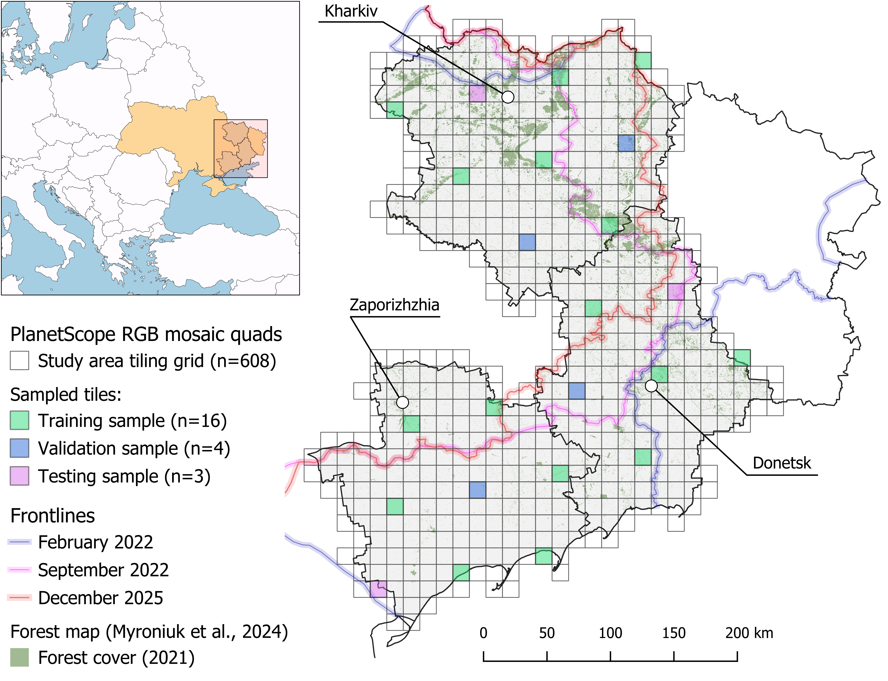

# Shelterbelt Segmentation from Planet Imagery in Eastern Ukraine

[](https://www.python.org/downloads/)
[](https://pytorch.org/)
[](https://git-lfs.github.com/)
[](https://opensource.org/licenses/MIT)
[](https://iopscience.iop.org/journal/1748-9326)

> [!NOTE]
> **Associated Publication**
>
> This repository provides the reproducible code, spatial partitions, reference delineations, pre-trained deep learning models, and regional prediction products accompanying the peer-reviewed research article:
>
> **"Deep learning reveals severe shelterbelt degradation in eastern Ukraine due to the war"**
>
> **Authors:** Viktor Myroniuk, Yevhenii Khan, Oleksandr Sovakov, Maksym Matsala, Andrii Lashchenko, Anatolii Makarevych, Andrii Terentiev
>
> Myroniuk et al 2026 Environ. Res. Lett. https://doi.org/10.1088/1748-9326/aebaa1.

---

## Study Area & Spatial Quad Partitions



*Figure 1: Study area across Kharkiv, Donetsk, and Zaporizhzhia oblasts in eastern Ukraine (accompanying Myroniuk et al., in press in Environmental Research Letters), showing the PlanetScope tiling grid (n=608), sampled training (n=16), validation (n=4), and testing (n=3) quads, frontline dynamics (February 2022, September 2022, December 2025), and 2021 baseline forest cover (Myroniuk et al., 2024; https://doi.org/10.1016/j.foreco.2024.122156).*

---

## Table of Contents

- [Overview](#overview)
- [Study Area & Spatial Partitioning](#study-area--spatial-partitioning)
- [Planet Imagery & E&R License Compliance](#planet-imagery--er-license-compliance)
- [Regional Prediction Products & Virtual Rasters (VRT)](#regional-prediction-products--virtual-rasters-vrt)
- [Pre-Trained Weights & Git LFS](#pre-trained-weights--git-lfs)
- [Repository Structure](#repository-structure)
- [Pipeline Stages](#pipeline-stages)
- [Quick Start](#quick-start)
  - [1. Environment Setup](#1-environment-setup)
  - [2. Reproduce Post-Processing & Loss Estimation (Notebook 007)](#2-reproduce-post-processing--loss-estimation-notebook-007)
  - [3. Full Sequential Pipeline Execution](#3-full-sequential-pipeline-execution)
- [Statistical Area Estimation (Olofsson et al. 2014)](#statistical-area-estimation-olofsson-et-al-2014)
- [Configuration Reference](#configuration-reference)
- [Citation](#citation)
- [License](#license)

---

## Overview

Shelterbelts are narrow, linear tree plantations established along agricultural field boundaries. They provide important ecosystem services: mitigating severe wind erosion, retaining winter snow cover, conserving soil moisture, and stabilizing dryland crop yields. Since 2014, and more intensively since full-scale Russian invasion in February 2022, active hostilities, intensive artillery bombardment, defensive fortifications, vehicle compaction, and uncontrolled wildfires in eastern and southern Ukraine have inflicted catastrophic damage on these protective networks. Because shelterbelts are typically only 10–30 meters wide, standard medium-resolution satellite sensors (e.g., Sentinel-2 10 m, Landsat 30 m) suffer from severe mixed-pixel effects, preventing their reliable detection.

This repository implements a high-resolution, deep learning semantic segmentation framework utilizing **4.7 m Planet basemaps and PlanetScope imagery** to map shelterbelt networks across 2021–2025. 

---

## Study Area & Spatial Partitioning

The study area encompasses three heavily conflict-affected oblasts in eastern Ukraine:
- **Kharkivska Oblast** (Kharkiv)
- **Donetska Oblast** (Donetsk)
- **Zaporizka Oblast** (Zaporizhzhia)

To prevent spatial autocorrelation and data leakage between training and evaluation, quads were partitioned into geographically separated subsets (`tile_splits.json`):
- **Training Set ($n=16$)**: `1223-1328`, `1223-1352`, `1224-1333`, `1227-1324`, `1227-1348`, `1229-1334`, `1232-1325`, `1232-1349`, `1233-1330`, `1233-1354`, `1235-1340`, `1236-1345`, `1238-1331`, `1238-1355`, `1239-1336`, `1244-1337`.
- **Validation Set ($n=4$)**: `1228-1329`, `1231-1344`, `1234-1335`, `1237-1350`.
- **Held-Out Test Set ($n=3$)**: `1222-1323`, `1228-1353`, `1240-1341` (manually delineated for both 2021 pre-war and 2025 post-invasion epochs).

---

## Planet Imagery & E&R License Compliance

> [!IMPORTANT]
> **Planet Labs Education and Research (E&R) License Notice**
>
> High-resolution satellite imagery used in this study was acquired under Planet Labs' Education and Research (E&R) Program. Planet Labs' Terms of Service strictly prohibit public redistribution, hosting, or sublicensing of raw GeoTIFF rasters on public repositories.
>
> In accordance with this legal framework:
> - **Raw input Planet GeoTIFFs are not hosted in this repository.**
> - Directory structures are preserved via `.gitkeep` files under [`images/`](images/).
> - All vector reference perimeters, configuration files, automated download scripts, pre-trained model weights, and derived regional classification mosaics are fully provided.

If you have a Planet Labs API account or E&R license, you can automatically download all required basemaps for this study area using the provided scripts in [`download_basemaps/`](download_basemaps/). See [`download_basemaps/README.md`](download_basemaps/README.md) for full instructions.

---

## Regional Prediction Products & Virtual Rasters (VRT)

To adhere to GitHub's **100 MB per-file threshold** without relying on external cloud storage links, wall-to-wall prediction products in [`outputs/`](outputs/) are divided into three regional GeoTIFFs corresponding to administrative oblasts:
- `*-done.tif` (Donetsk region, ~62–66 MB)
- `*-khar.tif` (Kharkiv region, ~56–60 MB)
- `*-zapo.tif` (Zaporizhzhia region, ~57–61 MB)

For seamless analysis across the entire study area, **GDAL Virtual Rasters (`.vrt`)** are provided for both baseline epochs:
- `outputs/2021/global_monthly_2021_voted_cl123_albers.vrt`
- `outputs/2025/global_monthly_2025_clean_cl123_albers.vrt`

### Opening Regional Outputs Seamlessly

The `.vrt` files use relative paths to reference the three regional GeoTIFFs. Any GIS software (QGIS, ArcGIS) or Python raster library opens them as a single unified mosaic without duplicating disk space:

```python
import rasterio

# Open the full study area seamlessly via VRT:
with rasterio.open("outputs/2021/global_monthly_2021_voted_cl123_albers.vrt") as src:
    print(f"Dimensions: {src.width} x {src.height} px")
    print(f"CRS: {src.crs}")
    print(f"Bounds: {src.bounds}")
```

Notebook [`notebooks/007_postprocessing.ipynb`](notebooks/007_postprocessing.ipynb) automatically detects and loads the `.vrt` files, falling back to monolithic or regional `.tif` files if required.

---

## Pre-Trained Weights & Git LFS

- **Pre-Trained U-Net Weights**: Available at [`models/unet_models/global_monthly_2021_07_mosaic_cl123_conv_best_model.pth`](models/unet_models/) (~93 MB).
- **Git Large File Storage (LFS)**: Configured in [`.gitattributes`](.gitattributes) to track `*.tif` and `*.pth` assets. When cloning this repository:

```bash
# Ensure Git LFS is installed
git lfs install

# Clone the repository and fetch large files
git clone https://github.com/victormy/shelterbelt-net.git
cd shelterbelt-net
git lfs pull
```

---

## Repository Structure

```
shelterbelt-segmentation-planet/
├── .gitattributes                    # Git LFS tracking for *.tif and *.pth
├── .gitignore                        # Git exclusion rules
├── LICENSE                           # MIT License
├── README.md                         # Main repository guide (this file)
├── requirements.txt                  # Python runtime dependencies
│
├── figures/                          # Publication figures & cartography
│   └── study_area_map.png            # High-resolution study area map
│
├── notebooks/                        # Sequential Jupyter workflow notebooks
│   ├── 000_multiseasonal_planet_stack.ipynb   # Multi-seasonal composite stacking
│   ├── 001_reclassify_by_stndtype.ipynb       # Vector reclassification & mask rasterization
│   ├── 002_create_training_dataset.ipynb      # 256x256 chipping with striding
│   ├── 003_train_val_test_model.ipynb         # Model training & validation benchmarking
│   ├── 004_run_inference.ipynb                # Sliding-window inference with Gaussian blending
│   ├── 005_mosaic_predicted_tiles.ipynb       # Ukraine Albers reprojection & mosaicking
│   ├── 006_voted_mosaics.ipynb                # Multi-temporal ensemble voting
│   ├── 007_postprocessing.ipynb               # Error-adjusted area estimation (Olofsson et al.)
│   ├── config.py                              # Local configuration module
│   ├── pipeline.py                            # Local pipeline engine
│   ├── requirements.txt                       # Notebook requirements
│   ├── tile_splits.json                       # Local tile splits
│   └── README.md                              # Notebook documentation
│
├── delineation/                      # Ground-truth reference perimeters (GeoJSON)
│   ├── all_3857_2021/                # 23 pre-war tile delineations (EPSG:3857)
│   ├── all_3857_2025/                # 3 post-invasion held-out test delineations (EPSG:3857)
│   └── README.md                     # Delineation protocols and attribute documentation
│
├── download_basemaps/                # Automated Planet Basemaps API download tooling
│   ├── aoi.geojson                   # Outer study area AOI in EPSG:4326
│   ├── khar-done-zapo.geojson        # Oblast boundaries (Kharkiv, Donetsk, Zaporizhzhia)
│   ├── all_quads.geojson             # Complete quad grid intersecting the AOI (EPSG:4326)
│   ├── sampled_quads.geojson         # Subset of sampled quads
│   ├── mosaic_ids.csv                # Lookup table of Planet monthly basemap UUIDs
│   ├── config.yaml                   # API download configuration
│   ├── create_quad_index.py          # Queries Planet API to index intersecting quads
│   ├── download_by_tile_index.py     # Concurrent GeoTIFF downloader via BasicAuth
│   └── README.md                     # Detailed download guide
│
├── images/                           # Satellite imagery directory tree template
│   ├── 2021/                         # Pre-war monthly basemaps (train/val/test/all)
│   ├── 2025/                         # Post-invasion monthly basemaps (06-09)
│   └── README.md                     # Image directory structure and mapping rules
│
├── models/                           # Model checkpoints & training logs
│   └── unet_models/
│       ├── global_monthly_2021_07_mosaic_cl123_conv_best_model.pth           # Best weights (~93 MB)
│       ├── global_monthly_2021_07_mosaic_cl123_conv_performance_metrics.png # Training curves
│       └── global_monthly_2021_07_mosaic_cl123_conv_training_history.pth     # Training history
│
├── outputs/                          # Final classification products (Ukraine Albers)
│   ├── 2021/
│   │   ├── global_monthly_2021_voted_cl123_albers-done.tif  # Donetsk region (66 MB)
│   │   ├── global_monthly_2021_voted_cl123_albers-khar.tif  # Kharkiv region (60 MB)
│   │   ├── global_monthly_2021_voted_cl123_albers-zapo.tif  # Zaporizhzhia region (61 MB)
│   │   └── global_monthly_2021_voted_cl123_albers.vrt       # Virtual raster linking all 3
│   └── 2025/
│       ├── global_monthly_2025_clean_cl123_albers-done.tif  # Donetsk region (62 MB)
│       ├── global_monthly_2025_clean_cl123_albers-khar.tif  # Kharkiv region (56 MB)
│       ├── global_monthly_2025_clean_cl123_albers-zapo.tif  # Zaporizhzhia region (58 MB)
│       └── global_monthly_2025_clean_cl123_albers.vrt       # Virtual raster linking all 3
│
└── tests/                            # Automated test suite
    ├── conftest.py                   # Pytest fixtures & mock raster generation
    ├── test_config.py                # Unit tests for parameter loaders & normalizations
    └── test_pipeline.py              # Unit tests for core processing functions
```

---

## Pipeline Stages

| Stage | Notebook / Function | Core Output | Description |
|:---:|:---|:---|:---|
| **000** | `000_multiseasonal_planet_stack.ipynb`<br>`pipeline.stack_multiseasonal()` | 9-band GeoTIFFs | Stacks April, July, and October RGB basemaps per quad to capture seasonal phenology. |
| **001** | `001_reclassify_by_stndtype.ipynb`<br>`pipeline.reclassify_masks()` | Binary mask GeoTIFFs | Filters vector perimeters by `STND_CODES` (`[1, 2, 3]`), fixes geometries, and rasterizes masks. |
| **002** | `002_create_training_dataset.ipynb`<br>`pipeline.chip_training_dataset()` | $256 \times 256$ image/mask chips | Chips quads and masks with spatial striding (128 px for training, 256 px for validation/test). |
| **003** | `003_train_val_test_model.ipynb`<br>`pipeline.train_model()` | PyTorch `.pth` checkpoint | Trains segmentation model with Dice loss, AdamW optimizer, and Cosine Annealing schedule. |
| **004** | `004_run_inference.ipynb`<br>`pipeline.run_inference()` | Quad probability GeoTIFFs | Sliding-window inference with **2D Gaussian kernel weighting** (128 px overlap) and thresholding. |
| **005** | `005_mosaic_predicted_tiles.ipynb`<br>`pipeline.mosaic_predictions()` | Ukraine Albers GeoTIFF | Merges quad predictions and reprojects from EPSG:3857 to Ukraine Albers Equal Area. |
| **006** | `006_voted_mosaics.ipynb`<br>`pipeline.vote_predictions()` | Annual ensemble GeoTIFF | Pixel-level voting across monthly predictions (June–September) for temporal stability. |
| **007** | `007_postprocessing.ipynb`<br>Post-processing analysis | Error matrix & loss tables | Difference mapping, skeletonization, and **Olofsson et al. (2014)** error-adjusted area estimation. |

---

## Quick Start

### 1. Environment Setup

Clone the repository and install dependencies in a Python 3.10+ environment:

```bash
git clone https://github.com/victormy/shelterbelt-net.git
cd shelterbelt-net
pip install -r requirements.txt
```

*(Optional)* Set the `GEOAI_ROOT` environment variable if your data root differs from the repository root:
```bash
export GEOAI_ROOT=/path/to/data
```
By default, `config.py` automatically resolves the repository root without requiring manual path changes.

### 2. Reproduce Post-Processing & Loss Estimation (Notebook 007)

You can immediately reproduce the error-adjusted loss metrics, confusion matrices, and confidence intervals without downloading satellite imagery:

```bash
cd notebooks
jupyter lab 007_postprocessing.ipynb
```

The notebook automatically:
- Resolves paths relative to `config.GEOAI_ROOT`.
- Detects and loads the provided regional prediction products via virtual rasters (`outputs/2021/*.vrt` and `outputs/2025/*.vrt`).
- Computes sample error matrices across held-out test quads.
- Executes $N=1{,}000$ spatial block-bootstrap iterations to quantify net shelterbelt loss and uncertainty.

### 3. Full Sequential Pipeline Execution

To train models from scratch or run inference on new imagery, open and run the notebooks in sequence (`000` through `007`), or call the pipeline functions directly in Python:

```python
import pipeline

# Stage 1: Rasterize vector masks
pipeline.reclassify_masks()

# Stage 2: Chip satellite imagery and masks
pipeline.chip_training_dataset()

# Stage 3: Train model
history = pipeline.train_model()

# Stage 4: Run Gaussian sliding-window inference
pipeline.run_inference()

# Stage 5: Mosaic and reproject to Ukraine Albers
pipeline.mosaic_predictions()
```

---

## Statistical Area Estimation (Olofsson et al. 2014)

Pixel counting on satellite-derived land-cover maps introduces systematic area bias due to classification error. Notebook [`notebooks/007_postprocessing.ipynb`](notebooks/007_postprocessing.ipynb) applies the good-practice stratified area estimator established by **Olofsson et al. (2014)** (*Remote Sensing of Environment* 148:42–57):

1. **Error Matrix ($p_{ij}$)**: Formed across held-out test quads comparing map predictions against high-resolution reference delineations for 2021 and 2025.
2. **Stratum Weighting ($W_i$)**: Each mapped stratum $i$ (shelterbelt vs. non-shelterbelt) is weighted by its proportion of total mapped area:
   $$W_i = \frac{A_{\text{map}, i}}{A_{\text{total}}}$$
3. **Unbiased Area Estimation ($\hat{A}_k$)**:
   $$\hat{A}_k = A_{\text{total}} \sum_{i} W_i \frac{n_{ik}}{n_{i\cdot}}$$
4. **Spatial Block-Bootstrap**: Adjacent 4.7 m pixels exhibit strong spatial autocorrelation. To prevent variance underestimation, the notebook resamples $256 \times 256$ px spatial blocks with replacement ($N=1{,}000$ iterations) to report robust 95% confidence intervals on gross loss, gross gain, and net change.

---

## Configuration Reference

All processing parameters are consolidated in [`config.py`](config.py):

| Parameter | Default Value | Description |
|---|:---:|---|
| `GEOAI_ROOT` | Auto-detected | Base directory path for imagery, delineations, models, and outputs |
| `YEAR` | `"2021"` | Active processing epoch (`"2021"`, `"2022"`, ..., `"2025"`) |
| `DATA_TYPE` | `"global_monthly_2021_07_mosaic"` | Input satellite raster collection identifier |
| `ARCHITECTURE` | `"_conv"` | Backbone: `"_conv"` (U-Net ResNet34) or `"_trans"` (SegFormer MiT-B0) |
| `NORMALIZE` | `"minmax"` | Preprocessing: `"minmax"` (0–1 per chip) or `"imagenet"` |
| `STND_CODES` | `[1, 2, 3]` | Included stand types (`1` = field shelterbelts, `2` = infrastructure, `3` = other linear) |
| `CHIP_SIZE` | `256` | Square chip dimension in pixels |
| `TRAIN_STRIDE` | `128` | Stride for training chips (50% spatial overlap) |
| `EVAL_STRIDE` | `256` | Stride for validation/test chips (0% overlap) |
| `INFERENCE_OVERLAP`| `128` | Overlap for 2D Gaussian sliding-window blending (pixels) |
| `BATCH_SIZE_TRAIN`| `8` | Training batch size |
| `NUM_EPOCHS` | `50` | Maximum training epochs |
| `PATIENCE` | `15` | Early stopping patience (epochs without validation IoU gain) |
| `THRESHOLD` | `0.5` | Sigmoid classification threshold |

---

## Citation

If you use this workflow, pre-trained weights, or reference delineations in your research, please cite:

```bibtex
@article{myroniuk2026shelterbelts,
  title={Deep learning reveals severe shelterbelt degradation in eastern Ukraine due to the war},
  author={Myroniuk, Viktor and Khan, Yevhenii and Sovakov, Oleksandr and Matsala, Maksym and Lashchenko, Andrii and Makarevych, Anatolii and Terentiev, Andrii},
  journal={Environmental Research Letters},
  year={2026},
  publisher={IOP Publishing}
}
```

---

## License

This project is licensed under the **MIT License** — see the [LICENSE](LICENSE) file for details.
Satellite imagery access is governed by Planet Labs PBC terms under the Education and Research (E&R) Program.
